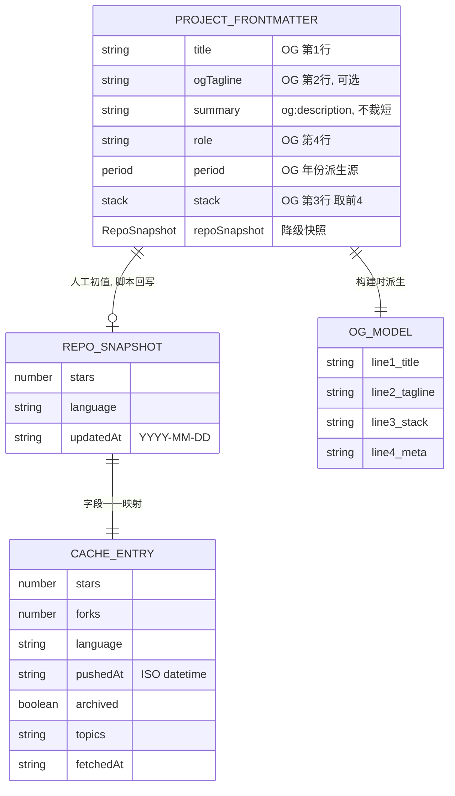
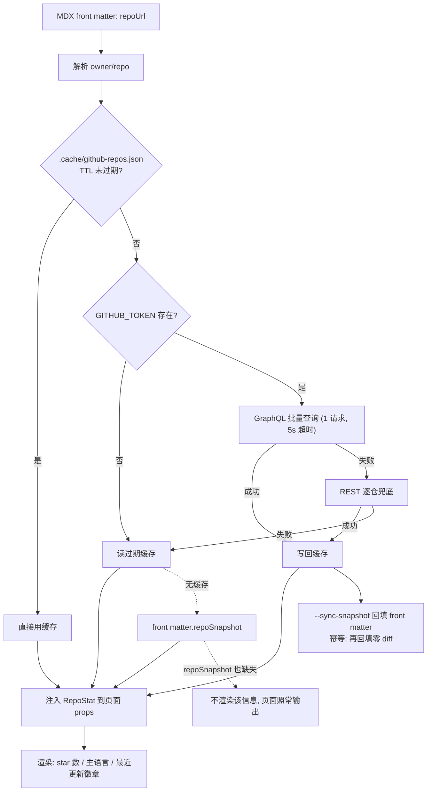
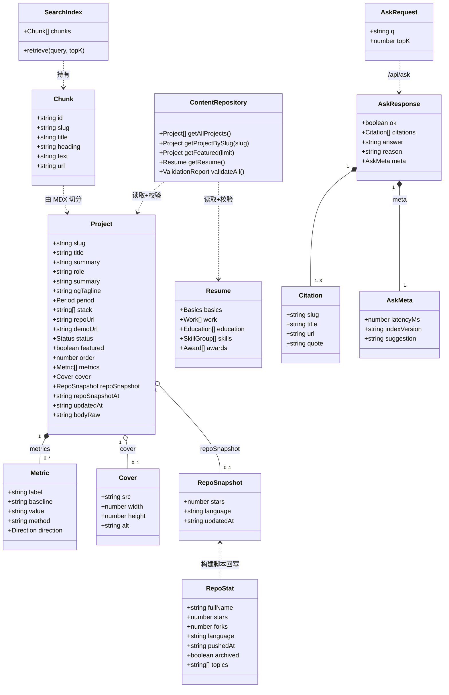
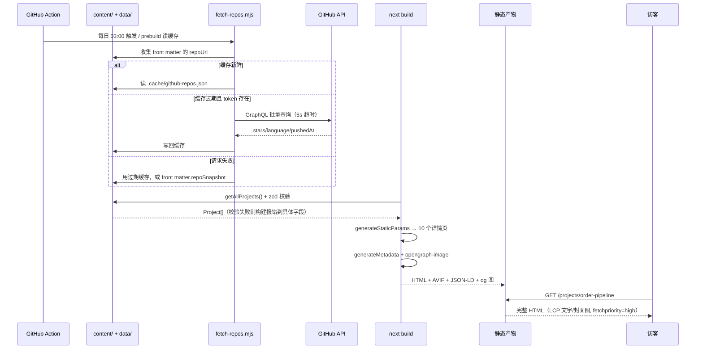
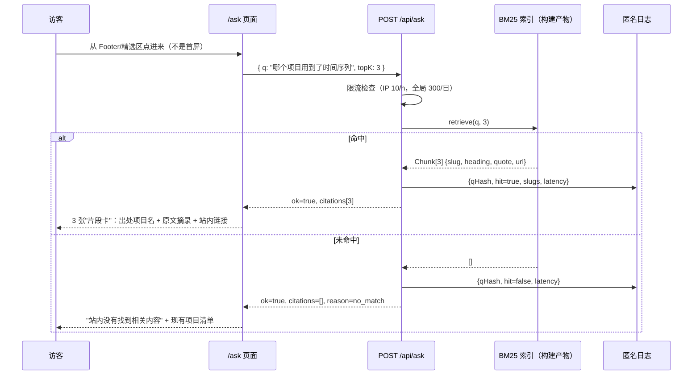
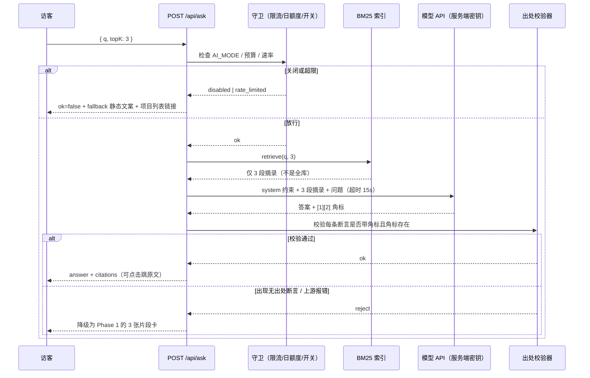
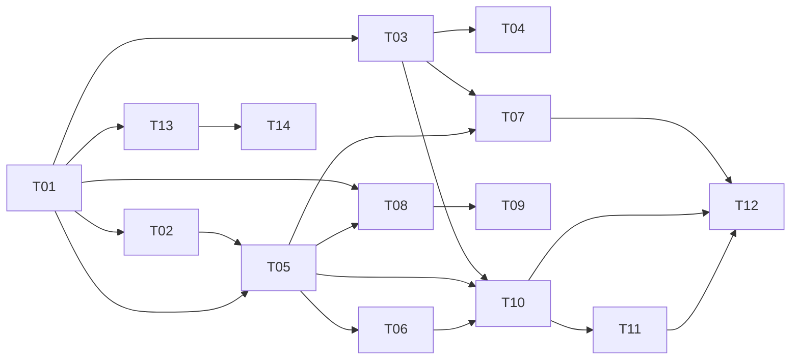

# 个人简历 / 项目展示网站 —— 系统设计方案与任务分解

> 设计人：高见远（架构师）｜日期：2026-11-17｜输出语言：简体中文
> 上游输入：`docs/01-research-personal-site.md`（许清楚，竞品调研）
> 本文档不写代码，只给决策、契约、结构与可开工的任务分解。

---

## 0. 一句话方案

用 **Next.js 16 App Router（Active LTS）静态化渲染**做「首页单页摘要 + `/resume` + `/projects` + `/projects/[slug]`」的多路由内容站：结构化字段进类型化 data（对齐 JSON Resume），长叙事进 MDX（`@mdx-js/mdx` 在 RSC 内编译 + front matter 走 zod 校验），GitHub 仓库信息**构建时拉取 + 落盘缓存 + 三层降级**，AI 模块收敛为**独立 `/ask` 页面的站内检索**（Phase 1 纯 BM25 检索、零模型成本、必带站内出处，Phase 2 视评测集决定是否加 LLM 组答），首屏只讲清"我是谁、做过什么、点哪里看源码"。

---

## 1. 前提：调研结论 → 设计约束的映射

调研给出的不是"参考意见"，而是已经闭合的约束。下面这张表是本设计所有后续决策的源头，每一条都能回指调研的具体章节。

| # | 调研结论（出处） | 转成的设计约束 | 落点 |
|---|---|---|---|
| C1 | 11 个候选里 7 个是无详情页的单页（§3.2） | 形态必须是**多路由**，每页有独立可抓取的静态 HTML 与分享卡 | §2.1 框架选型、§3 路由表 |
| C2 | 全配置化写不了长文，全 API 化"站点里没有一句你自己写的话"（§5.7） | 内容层**分层**：结构化字段走 data，叙事走 MDX + 固定 schema | §2.3 |
| C3 | 招聘侧口径 = Context→Constraint→Decision→Trade-off→**Outcome**，缺 Outcome 判低杠杆（§5.3） | 详情页有**固定叙事骨架**，`metrics` 是必填语义字段，构建时 lint | §2.3、§10.7 第 3 条 |
| C4 | 三例 GitHub API 集成都需要缓存与降级（§6.1 M3） | 构建时拉取、落盘缓存、**浏览器端不直连**、取不到不许报错 | §2.5 |
| C5 | Three.js 站的 LCP 被 `opacity:0.004` 的文字记到 9–20s；canvas 永远不是 LCP（§5.4） | 首屏 LCP 元素只能是纯文字标题或 ≤150KB 海报图，动效延迟到 idle/进视口 | §8 性能预算 |
| C6 | 90% 模板只有 `<title>`，分享到微信/飞书是空白卡片（§5.6） | metadata + og:image（详情页自动生成）+ JSON-LD + sitemap + canonical 属**第一天**工作 | §9 T10–T11 |
| C7 | star 最高的 5 个模板都没有 AI；做了的 4/5 是"简历 RAG 聊天框"且已商品化（§6.4 A） | AI **不作为门面**，差异化落在"回答准不准"，入口不放首屏 | §7 |
| C8 | 失败点全在工程侧：内容不同步、全库塞 prompt、禁止说"不知道"、冷启动、架构失控（§6.4 A3） | 检索范围=站内内容、回答必带出处、必须能说"站里没有"、无 LLM 也能工作、拒绝为聊天框引入向量库 | §7.4–7.6 |
| C9 | 唯一做得好的是"特定任务 + gold-set 评测集"（§6.4 A4） | **评测集是上 LLM 的前置条件**，不是可选优化 | §7.7 |
| C10 | mldangelo 把 320px / 200% 字号 / 高对比列为验收项（§5.5） | 响应式与 a11y 进验收标准，不是"后续优化" | §8 可访问性验收 |

---

## 2. 技术选型（每项一个结论 + 理由 + 被否方案）

### 2.1 框架：**Next.js 16 App Router（Active LTS，推荐 A）**

需求里藏着两条硬约束，它们直接排除了一半选项：**(a) 每个项目详情页要有独立 URL 的可被抓取的静态 HTML 与分享卡**（C1/C6）；**(b) AI 密钥必须留在服务端**（C8）。

| 维度 | A) Next.js 16 App Router | B) Astro + React islands | C) Vite SPA + serverless |
|---|---|---|---|
| 首屏性能 | 高（页面默认 RSC/SSG，内容页可做到零客户端 JS） | 最高（默认零 JS，略优于 A） | 中（HTML 是空壳，LCP 依赖 JS 执行与 hydration） |
| SEO / 分享卡 | **原生**：`generateMetadata` + 静态 HTML + `next/og` 自动生成卡片 | 强（静态 HTML 原生），但 og 卡片要自接 satori + resvg | **不合格**：微信/飞书/Slack 抓取不执行 JS → 空白卡片（正是 C6 的失败） |
| AI 服务端能力 | 同仓 Route Handler，一次部署、一个域名、无跨域 | 需 adapter 服务端路由或**第二个**部署单元 | 必须独立 function，跨域 + 密钥分发 + 两处部署 |
| MDX 编写体验 | 好（`@mdx-js/mdx` 的 `evaluate()` 在 RSC 内直接编译 + zod 校验，约 80 行，**零第三方包装**） | **最好**（content collections 内置 zod 校验与构建报错） | 差（需从零搭） |
| 构建与心智成本 | 中（要理解 RSC/客户端组件边界） | 中高（Astro 模板语法 + React islands 两套模型） | 低（纯 React）但 SEO 补齐成本极高 |
| 部署成本 | Node 运行时（Vercel 免费档）；`AI_MODE=off` + `output:'export'` 后任意静态托管 | 静态任意托管；AI 需额外函数 | 前端随处 + 函数平台两套配置 |

**结论：选 A。三条理由：**

1. **一个仓、一次部署，同时满足 (a) 与 (b)。** `generateStaticParams` 让每个项目在构建期各自产出静态 HTML；`app/api/ask/route.ts` 让密钥只出现在服务端环境变量里。C 方案要满足 (a) 就得自己写预渲染层——那等于重造一个更差的 Next。
2. **风险最低。** 调研里工程完整度最高的两个参照都是 Next：timlrx 的"每页 metadata + JSON-LD + 自动 sitemap + 自动 og 图"，mldangelo 的"可打印简历 + 同时发布 JSON Resume + 自动分享卡 + CI 死链检查"。我们做的事退化成"照着成熟样本裁剪"，而不是"验证一条没人走过的路"。
3. **性能上限不由框架决定，由 JS 预算决定。** Next 的"重"来自滥用客户端组件。我们把内容页客户端 JS 压到 ≤60KB gz（§8），首屏只有主题切换一个交互组件，实际体感与 Astro 同级。

#### 2.1.1 版本与安全基线（2026-11-17 核对）

| 项 | 锁定的基线 | 依据与动作 |
|---|---|---|
| Next.js | **`next@^16.4.6`**（16.x = Active LTS，2025-10-21 发布；16.4.6 为 2026-11-09 当前最新） | 15.x 已进 Maintenance LTS、安全支持窗口到 2027-01-31 结束；新项目从 15 起步等于三个月后必须升级。**不允许 `<16`** |
| React | **19.3**（随 16.4 进入） | 由 Next 16.4 自带，不再单独放宽；`react`/`react-dom` 与 `@types/react*` 同批锁定 |
| TypeScript | **≥5.1**，`strict: true` | Next 16 最低要求 5.1 |
| Node.js | **≥20.9**（CI 与本地同版本，写进 `.nvmrc` 与 `engines`） | Next 16 不再支持 Node 18 |
| Tailwind | v4（`@tailwindcss/postcss`） | — |
| 安全频次 | 2026-07 起 Next 改为**每月一次**的例行安全发版 | 因此 CI 必须能低成本吸收 patch：`pnpm audit --audit-level=high`（报告不全绿则告警，不阻塞合并）+ **Renovate 只自动合并 patch**（minor 走人工），升级周期写进 README 维护清单 |

锁补丁版：16.4.5 / 16.4.6 修的是 Cache Components 相关 7 中危 + 1 高危；2025-12 的 React2Shell（CVE-2025-55182，CVSS 10.0）证明"晚两周再升级"的代价可能是轮换所有密钥。

#### 2.1.2 Cache Components：**显式关闭（选 a）**

16.4 起 `create-next-app` 新建应用**默认写入 `cacheComponents: true`**，17 将成框架默认。必须显式写 `cacheComponents: false`，理由三条：

1. **收益完全不匹配。** Cache Components 解决的是"同一响应里混排静态壳 + 缓存岛 + 请求时子树"，而本站**全部路由构建期静态、零请求时数据**——没有可被它优化的东西，只多出 `use cache` / `cacheLife` / `blocking-route` 三组概念。
2. **它会焊死 §2.6 的纯静态逃生口。** Cache Components **依赖 Node.js 运行时，不支持静态导出**（`output: 'export'` 无法使用）。"AI 关掉后能上任意静态托管（含 GitHub Pages）"正是 §2.6 在"部署成本"维度成立的前提，也是"AI 可整块删除"的物理基础。开着它，`AI_MODE=off` 仍只能跑在有 Node 的平台上——**退路就没了**。
3. **(b) 唯一的实质好处可以用更便宜的方式买到。** 开启 Cache Components 的价值之一是 `ensureStatic` 能把"某个页面偷偷变成动态"变成构建失败。我们用两条零成本规则替代：① CI 断言 `next build` 路由表里**没有任何 `ƒ`（动态）标记**；② ESLint `no-restricted-imports` 禁止 `app/**`、`components/**` 引入 `next/headers` 与 `connection`。

**迁移计划**：等 Next 17 把它变成默认时再迁移，届时迁移面只有 6 个页面 + 1 个 POST 路由，是"删配置 + 补 `use cache`"的机械工作。**T01 的 `next.config.ts` 必须显式写 `cacheComponents: false` 并附注释**（不能省略——省略等于继承 `create-next-app` 的默认 `true`）。


**被否方案 B（Astro）的否决理由**：它换来的两样东西（默认零 JS、content collections 的 schema 校验）我们能在 Next 里以很小成本补上（RSC 页面 + 手写 zod 校验）；付出的代价是两套渲染心智、og 图要自己搭 satori 管线、AI 端点多一个部署单元。**这是本设计唯一"可能后悔"的地方**，所以 §2.6 把 AI 做成可整块删除。
**被否方案 C（Vite SPA）的否决理由**：需求 (a) 直接判死。补 prerender 后得到的是"配置更零碎的 Next"，没有任何一项占优。

### 2.2 样式：**只用 Tailwind CSS v4（+ CSS 变量 + 少量 Radix 无样式组件），不引入 MUI**

| 维度 | Tailwind only | MUI + Tailwind 并存 |
|---|---|---|
| Bundle | 只产出用到的原子类，CSS ~8–15KB gz | MUI 基础运行时 + 主题 ≈ 90–130KB gz |
| 与 RSC 协作 | 零运行时 | emotion 需 `AppRouterCacheProvider`，多一层运行时 |
| 设计 token 来源 | 单一（CSS 变量） | 双份（`theme.palette` 与 `tailwind.config`），必然漂移 |
| 需要的组件数 | 本站 <15 个（Header/Footer/Button/Badge/Card/Tag/Timeline/MetricStat/Dialog/Prose…） | — |

**结论：不引入 MUI。** MUI 解决的是"没有设计稿也要有 50 个组件"的问题，本站是要"一个克制的、有个人辨识度的视觉"，组件库反而是负担；而且调研里三个工程完整度最高的样本（devportfolio Astro+Tailwind、timlrx、mldangelo）全是 Tailwind 系。逃生口：复杂无障碍交互（Dialog / Tabs / Tooltip）用 Radix primitives（无样式，单件 5–12KB）。

**被否方案（MUI）否决理由**：bundle 占满整个 JS 预算；`sx` 与 class 混写后样式来源不可追。

### 2.3 内容存储：**MDX 文件 + `@mdx-js/mdx` 在 RSC 内编译 + zod 校验**（不用 contentlayer、不用 next-mdx-remote、不用纯 data）

**目录约定：**

```
content/projects/<slug>.mdx        # 项目详情（唯一内容源）
content/pages/about.mdx            # 可选：长文自我介绍
src/data/resume.ts                 # 结构化简历（对齐 JSON Resume 子集）
src/data/site.ts                   # 站点级常量：姓名、SITE_URL、社交链接、导航项
```

**编译路径：用核心 `@mdx-js/mdx` 的 `evaluate()`，不引入包装库。** `lib/content/mdx.ts` 里一个 `compileMdx(source)`：`gray-matter` 拆 front matter → `zod` 校验 → `evaluate(body, { ...runtime, components })` 产出 RSC 可直接渲染的组件。

**必须记录的一条事实**：原先常用的 `next-mdx-remote` 已于 **2026-04-09 被 HashiCorp 归档**（最后一版 v6.0.0，2026-02），只读、不再有安全修复。这是调研 §5.7 教训的再现：**单人维护的依赖会死**。所以本站选依赖面最小的那条路——核心 `@mdx-js/mdx` 由 MDX 官方维护，我们只多写约 80 行（front matter 拆分 + zod + 组件映射），换掉一个可能再次归档的中间层。

**被否方案：`next-mdx-remote-client`（社区维护的替代 fork）** —— 它是当前活跃选项（v2.x，明确测过 Next 15/16 与 React 19.1+，自带 `onError` 错误边界与 export 语句支持）。否决理由：它同样是单人维护的 fork，刚吃过的亏不必再吃第二次；本站仅 6 个路由、内容 <15 篇，它给的错误边界与 frontmatter 助手 20 行代码即可覆盖。**日后内容量或协作复杂度上来再切它有明确迁移路径**（改动集中在 `lib/content/mdx.ts`）。
**被否方案：contentlayer（类工具）** —— 需额外构建步骤与 Next 插件，自 2023 年失去维护、从未支持 React 19；而我们要的只是"读目录 + 校验 front matter"，`fs` + `gray-matter` + `zod` 就能自持，且**校验失败能给出精确到字段的中文报错**（"缺 metrics 就警告"的 lint 需要它）。
**被否方案：纯 data 文件（devportfolio/developerFolio 式）** —— 字段僵硬、写不了长文，这正是 C2 判定要避开的坑。

**front matter 完整字段表**（`ProjectFrontmatter`）：

| 字段 | 类型 | 必填 | 写入方 | 说明 | 示例 |
|---|---|---|---|---|---|
| `title` | string (≤16 字) | ✔ | 人工 | 项目名，进列表、详情 `h1`、**OG 图第 1 行** | `实时订单履约管道` |
| `slug` | string (kebab) | ✔ | 人工 | URL 段；构建时校验与文件名一致 | `order-pipeline` |
| `summary` | string (40–120 字) | ✔ | 人工 | 一句话：**做了什么 + 带来什么**；进卡片与 `og:description`（SEO 用，不裁短） | `把履约延迟从 40s 降到 3s，支撑日均 120 万单` |
| `ogTagline` | string (≤24 字) | | 人工 | **仅 OG 图第 2 行用**的短句；缺省时从 `summary` 取首句（见下方派生规则） | `P95 延迟 40s → 3s` |
| `role` | string | ✔ | 人工 | 你的角色与范围（不是职级）；进 OG 图第 4 行 | `后端负责人（带 2 人）` |
| `period` | `{start: YYYY-MM, end?: YYYY-MM}` | ✔ | 人工 | `end` 缺省表示"至今"；**OG 图的年份由此派生** | `{start:"2024-03",end:"2024-11"}` |
| `team` | string | | 人工 | 团队规模与协作方 | `3 后端 + 1 设计` |
| `company` | string | | 人工 | 关联 `resume.work[].name`，用于交叉链接 | `某电商平台` |
| `stack` | string[] (1–8) | ✔ | 人工 | 技术栈，筛选数据源；**OG 图取前 4 个** | `["TypeScript","Postgres","Redis"]` |
| `repoUrl` | string(url) | | 人工 | GitHub 仓库；**缺失则卡片不渲染"源码"按钮**，也不会有快照 | `https://github.com/me/x` |
| `demoUrl` | string(url) | | 人工 | 线上演示 | `https://x.demo.dev` |
| `status` | enum `shipped\|archived\|wip\|concept` | ✔ | 人工 | 卡片徽章 + JSON-LD 的 `creativeWorkStatus` | `shipped` |
| `featured` | boolean | ✔ | 人工 | 是否进首页精选（构建时校验 ≤3 个） | `true` |
| `order` | number | ✔ | 人工 | 列表排序权重，小在前 | `10` |
| `metrics` | `Metric[]` | ✔（可空数组，但 lint 警告） | 人工 | 结构见下方（结构化对象，**不是字符串数组**） | `[{...}]` |
| `cover` | `{src,width,height,alt}` | ✔ | 人工 | **必带尺寸**，杜绝 CLS | `{src:"/img/order.avif",width:1600,height:900,alt:"订单看板"}` |
| `tags` | string[] | | 人工 | 主题标签（与 stack 区分：性能/增长/可观测性） | `["性能","可观测性"]` |
| `repoSnapshot` | `{stars,language,updatedAt}` | | **脚本回写**（也可手工初值） | GitHub 降级快照，**必须提交进仓库**，是 CI 首次构建不为空的保证（§2.5） | `{stars:42,language:"TypeScript",updatedAt:"2026-09-28"}` |
| `repoSnapshotAt` | `YYYY-MM-DD` | | 脚本回写 | 快照的抓取日期，用于卡片上标注"数据截至" | `2026-11-17` |
| `links` | `{label,url}[]` | | 人工 | 文章/文档/演讲等附加链接 | `[{label:"设计文档",url:"…"}]` |
| `confidentiality` | string | | 人工 | 脱敏声明，渲染在详情页顶部 | `客户数据已脱敏，指标为同量级近似` |
| `updatedAt` | `YYYY-MM-DD` | ✔ | 人工 | 进 sitemap `lastmod`、卡片"更新于"；**不参与 OG 图** | `2026-10-02` |
| `draft` | boolean | | 人工 | `true` 时仅 dev 可见，**CI 拦截泄漏** | `false` |

**（1）分享卡字段的结论：全部派生 + 仅引入一个可选短句 `ogTagline`，不引入 `ogTitle` / `ogSubtitle`。**

OG 图是 1200×630 的四行版式，四行各自的来源固定下来（`src/lib/seo/og-model.ts` 里一个纯函数 `buildOgModel(project)`，T01 定义、T11 只负责渲染）：

| OG 行 | 内容 | 派生规则 | 长度约束与兜底 |
|---|---|---|---|
| 第 1 行（主标题） | 项目名 | `title` | ≤16 字；超限时先自动降一档字号，仍超则 lint 警告要求改短 `title`（**不用 `ogTitle` 覆盖**，避免两处标题不一致） |
| 第 2 行（定位） | 一句话 | `ogTagline` → 缺省取 `summary` 的首句（截到第一个 `。` / `.`） | ≤24 字；派生结果超 24 字时**渲染层截断 + 省略号并 lint 警告**，提示补 `ogTagline` |
| 第 3 行（技术栈） | 标签条 | `stack.slice(0,4)` | 每个标签 ≤10 字，超出截断；标签总数 >4 时末尾显示 `+N` |
| 第 4 行（年份 + 角色 + 站点） | `2024 · 后端负责人 · chenism.dev` | `period.end?.slice(0,4) ?? period.start.slice(0,4)+'–至今'` + `role` + `site.name` | 固定版式，不参与 lint |

为什么是"派生 + 一个短句"而不是纯派生、也不是三个覆盖字段：`summary` 是为列表卡片和 `og:description` 写的（40–120 字，影响 SEO 与可抓取性），如果为了塞进 OG 图把它压到 24 字，等于用分享卡牺牲搜索摘要；而纯自动截断会产出"半句话"的卡片（比不生成更糟）。给"短句"单独一个字段是唯一不牺牲任何一边的做法；`ogTitle` 则没必要——项目名过长用字号自适应解决更可靠，多一个标题字段就多一份"两处不一致"的债。`ogTagline` 选填且只在缺省时才回落到 `summary`，所以**已经写好的 MDX 不需要为了上线分享卡而返工**（只有觉得自动摘要不够短时再补一句）。

**（2）`repoSnapshot` 的存在理由是"CI 首次构建不能空白"**：`.cache/github-repos.json` 不保证在任何环境都存在（fork、清缓存、Actions 缓存失效），而 front matter 一定跟着仓库走。所以快照**必须是可提交、可 review 的普通字段**，初始值由作者手工填一次（或本地跑一次回填脚本），此后交给脚本维护。字段合并规则见 §2.5。

**`Metric` 的结构（最终结论：结构化对象，不是字符串数组）**

一句话定稿：`metrics: Metric[]`，`Metric = { label, value, method, baseline?, direction? }`。**不接受字符串数组**，四条理由：① 字符串无法渲染"基线 → 结果"对比条（`MetricsPanel` 的核心视觉）；② 无法 lint（"显著提升"这类词只能靠正则拦，而结构化把 `method` 变成必填就根治了）；③ AI 检索需要按字段识别"这是结果、这是测量方式"，纯文本会让 Phase 1 的块内加权失效；④ 字符串数组会退化成"我做了 X"，而 `method` 必填强制作者回答"你凭什么这么说"。

| 字段 | 类型 | 必填 | 说明 | 示例 |
|---|---|---|---|---|
| `label` | string | ✔ | 指标名（含口径与分位） | `履约延迟 P95` |
| `baseline` | string | | 改动前基线；空表示只有结果没有基线 | `40s` |
| `value` | string | ✔ | 结果值 | `3s` |
| `method` | string | ✔ | **怎么测的**：数据源 + 时间窗 + 样本范围 | `埋点 + BI 看板，2024-10~11 全量流量` |
| `direction` | enum `up\|down` | | 渲染箭头（`down` 用于延迟类指标） | `down` |

**给产品经理的叙事模板映射**（详情页「结果」段的填空句式，字段与句子一一对应，`scripts/check-content.mjs` 会校验这些字段存在）：

| 模板句式 | 用到的字段 | 缺失时 |
|---|---|---|
| `{label} 从 {baseline} 变为 {value}` | `label` + `baseline` + `value` + `direction` | 无 `baseline` 时降级为 `{label} 达到 {value}` |
| （括号内）`衡量方式：{method}` | `method` | **不允许缺失**，schema 层必填 |
| 卡片摘要句 `{value} 的 {label}` | `value` + `label` | — |
| 首页 `ProofStrip` 的 3 条硬指标 | 取 `featured` 项目里 `direction` 最明确、`baseline` 齐全的前 3 条 | 不足 3 条时少展示，不补凑 |

**无基线（`baseline` 缺失）时的降级写法**——最常见的情况（历史数据没留存、指标上线后才开始记），必须能写：

| 场景 | 写法 | 渲染结果 / 口径 |
|---|---|---|
| 无基线 | `label` + `value` + `method`（`direction` 可留空） | `履约延迟 P95 达到 3s（衡量方式：埋点 + BI 看板，2024-10~11 全量流量）`；不画"基线→结果"对比条，改画单值卡，无基线就不渲染箭头 |
| lint 口径 | `baseline` **非必填**，缺失不报错 | 但同一项目 `metrics` 里超过半数条目无 `baseline` 时给 `warn`："缺对比基准，招聘方无法判断改善幅度"——提醒，不拦截 |
| 想补强 | 用外部锚点替代内部基线：行业量级、两个项目的横向对比、用户行为变化（"客服工单从每天 20 张降到 0"），写进 `value` 或 `method` | `baseline` 只放**同一口径测出的旧值**，不要塞别的东西，否则它会变成第二个 `value` |

校验规则（`scripts/check-content.mjs`）：`value` / `baseline` 命中 `显著|大幅|明显|很多|若干` 直接报错（反面样本是 "Boosted engagement significantly"）；`metrics` 为空数组时输出 `warn` 而非失败（允许早期先上内容骨架，但每次构建都提醒）；`direction` 与 `baseline/value` 的数量级方向矛盾时（如 `up` 但 baseline 数值大于 value）给 `warn`。

```ts
// src/lib/content/schema.ts（示意契约，T01 实现；本块字段一经定稿即 M1 冻结，M3/M5/M6 只读不增）
const Metric = z.object({
  label: z.string().min(2),
  baseline: z.string().optional(),
  value: z.string().min(1).refine(v => !/显著|大幅|明显|很多|若干/.test(v), '结果必须是数字或可观察变化'),
  method: z.string().min(4),          // 必填：没有测量方式的结果不展示
  direction: z.enum(['up','down']).optional(),
});

// 与 .cache/github-repos.json 的字段一一对应（映射见 §2.5），可提交、可 review
const RepoSnapshot = z.object({
  stars: z.number().int().nonnegative(),
  language: z.string().nullable(),
  updatedAt: z.string().regex(/^\d{4}-\d{2}-\d{2}$/),   // 缓存里的 pushedAt 的日期部分
});

export const ProjectFrontmatter = z.object({
  title: z.string().min(2).max(16),
  slug: z.string().regex(/^[a-z0-9-]+$/),
  summary: z.string().min(20).max(120),
  ogTagline: z.string().min(4).max(24).optional(),      // 仅 OG 图第 2 行
  role: z.string().min(2),
  period: z.object({ start: z.string().regex(/^\d{4}-\d{2}$/), end: z.string().regex(/^\d{4}-\d{2}$/).optional() }),
  team: z.string().optional(),
  company: z.string().optional(),
  stack: z.array(z.string()).min(1).max(8),
  repoUrl: z.string().url().optional(),
  demoUrl: z.string().url().optional(),
  status: z.enum(['shipped','archived','wip','concept']),
  featured: z.boolean(),
  order: z.number().int(),
  metrics: z.array(Metric).default([]),
  cover: z.object({ src: z.string(), width: z.number().int(), height: z.number().int(), alt: z.string().min(4) }),
  tags: z.array(z.string()).default([]),
  repoSnapshot: RepoSnapshot.optional(),                // 脚本回写，必须进仓库
  repoSnapshotAt: z.string().regex(/^\d{4}-\d{2}-\d{2}$/).optional(),
  links: z.array(z.object({ label: z.string(), url: z.string().url() })).default([]),
  confidentiality: z.string().optional(),
  updatedAt: z.string().regex(/^\d{4}-\d{2}-\d{2}$/),
  draft: z.boolean().default(false),
});
```

**erDiagram（front matter ↔ 缓存 ↔ OG 模型 的字段归属，防止后期回填）**：



### 2.4 简历数据：**对齐 JSON Resume 子集**

**结论：对齐，但不引入其 CLI 作为构建依赖。** `src/data/resume.ts` 导出 `basics / work / education / skills / projects / awards` 六个字段（字段名与 JSON Resume 一致，不发明新名字），用 zod 校验后由 `getResume()` 转成页面用的 view model（排序、分组、日期格式化）。

**收益**：① 构建时脚本同时产出 `/resume.json`，可被 `resume-cli` 的 227 个主题消费——想换视觉风格或投不同岗位做"多版本简历"时零迁移；② 未来导出 PDF / HTML 不必重写渲染；③ AI 模块问"在 X 公司负责什么"时可以直接查结构化字段而不必解析段落（C2/C8 的交汇点，调研 §6.5 明确这两条互相绑定）。
**代价与边界**：JSON Resume 有些字段偏细（`languages` / `references` / `projects.highlights`），我们只实现需要的子集；`ProjectFrontmatter` 与 `resume.projects` 通过 `slug` 关联，避免同一项目写两遍（项目详情以 MDX 为准，`resume.json` 只留标题/摘要/链接）。
**被否方案：自定义简历结构** —— 立刻可用，但未来每次导出/换主题都要写适配层；而"对齐标准"的成本只是"起名时照抄"。

### 2.5 GitHub 仓库信息：**构建时拉取 + 落盘缓存 + 三层降级**

**结论**：`scripts/fetch-repos.mjs` 只在构建机 / CI 里跑，浏览器端永不直连（C4）。

- **何时跑**：① GitHub Action 每日 03:00 UTC 定时跑一次，结果写回 `.cache/github-repos.json` 并 bot commit，commit 触发重新部署（保证线上数据最多 24h 旧）；② `prebuild` 读缓存，若 TTL 过期且存在 `GITHUB_TOKEN`，最多花 5s 尝试刷新一次，**无论成败都继续构建**；③ 同一脚本带 `--sync-snapshot` 时**把结果回填到每篇 MDX 的 `repoSnapshot` / `repoSnapshotAt`**（见下方"回填规则"）。
- **缓存位置与结构**：`.cache/github-repos.json`（提交进仓库，作为部署产物的一部分）：
  ```json
  { "fetchedAt": "2026-11-17T03:00:00Z", "ttlHours": 24,
    "repos": { "me/order-pipeline": { "stars": 42, "forks": 3, "language": "TypeScript",
      "pushedAt": "2026-09-28T11:02:00Z", "archived": false, "topics": ["streaming"],
      "fetchedAt": "2026-11-17T03:00:00Z" } } }
  ```
- **字段与 TTL**：只取 `stars / forks / language / pushedAt / archived / topics`（都是"能一眼验证项目活跃度"的元数据）；TTL 24h（按仓库各自的 `fetchedAt` 判断，而不是全局）。不取 contributors（贵且无展示价值）。
- **缓存 ↔ front matter 的字段映射（必须一一对应，缺一不可）**：

  | 缓存字段 `.cache.repos[fullName]` | front matter `repoSnapshot` | 转换 | 缺失时 |
  |---|---|---|---|
  | `stars` | `stars` | 直接复制 | `null` 视为缺失 |
  | `language` | `language` | 直接复制，`null` 允许 | 不展示语言徽章 |
  | `pushedAt`（ISO datetime） | `updatedAt` | **截取日期部分** `slice(0,10)` | 不展示"最近更新" |
  | `fetchedAt`（ISO datetime） | （无对应，落到 `repoSnapshotAt`） | 取本次抓取日的日期部分 | — |
  | `forks` / `archived` / `topics` | **不入 front matter** | 仅运行时徽章使用 | 徽章不渲染 |

- **字段合并规则（渲染时，逐字段而非整块）**：
  1. **新鲜缓存命中** → 用缓存值；`repoSnapshot` 存在也不看（但保留在文件里，等下次回填刷新）。
  2. **缓存过期但可读**（stale-while-error）→ 仍用缓存值，卡片标"数据截至 {fetchedAt}"。
  3. **无缓存 / 缓存损坏** → 回落 `repoSnapshot`，卡片标"数据截至 {repoSnapshotAt}"，**且不显示 forks/archived**（前端按字段存在性渲染，不允许出现 `undefined` 或 `–` 占位）。
  4. **`repoSnapshot` 也缺失** → 整块社交证明不渲染，只留"源码"按钮；页面其余部分不受影响。
  5. **构建成功拉取后**：`--sync-snapshot` 把新值写回 MDX（这就是"成功→覆盖快照"，保证快照永远是最近一次已知真值，也保证下一个纯净环境首次构建不为空）。
- **回填的幂等性要求**：回填用 `gray-matter` 读 → 只改 `repoSnapshot` / `repoSnapshotAt` 两个字段 → 其余字段的顺序、引号风格、注释与正文原样写回；CI 里跑一次"回填后再回填"必须产生 **零 diff**（`scripts/check-content.mjs --idempotent`），否则同一个 PR 会因为格式抖动反复变更。只在值真正变化时才写文件，避免 bot 提交噪声。
- **请求策略**：单次 GraphQL 查询用 alias 批量取全部 ≤10 个仓库（**1 次请求**完成）；GraphQL 失败降级为 REST 逐仓（≤10 次）。CI 必带 `GITHUB_TOKEN`（5000/h），本地无 token 也能跑（60/h 足够）。
- **三层降级**（顺序严格）：新鲜缓存 → 过期缓存（stale-while-error）→ front matter 的 `repoSnapshot` → 该信息整体不渲染（`repoUrl` 缺失时连"源码"按钮都不出现）。
- **CI 不因限流失败**：脚本捕获全部异常、只打 `warn` 日志、**恒 `exit 0`**；严格模式 `--strict`（有失败即非零退出）只挂在独立 job 上并设 `continue-on-error: true`，仅供观察。

**数据流（构建时）**：



### 2.6 运行形态与部署：**`AI_MODE` 三档 + 纯静态可回退**

| `AI_MODE` | 能力 | 需要运行时 | 部署选项 |
|---|---|---|---|
| `off` | `/ask` 不渲染、`/api/ask` 返回 404 | 否 | 任意静态托管（Vercel/Cloudflare Pages/GitHub Pages），或 `output:'export'` |
| `retrieval`（**推荐默认**） | 关键词检索返回站内片段 + 链接，**零模型调用** | 是（一个 Route Handler） | Vercel 免费档 / 任意 Node 宿主 |
| `answer`（Phase 2，可选） | 检索 + LLM 组答（必带出处、必须承认不知道） | 是 + 模型密钥 | 同上 + 密钥与限额 |

这个设计的目的只有一个：**把"是否上 AI 服务器"还原成一个环境变量**，而不是一个架构决定。任何一个页面在构建期都不依赖 `/api/*`，所以撤掉 AI 不会影响站点。

⚠️ 与 §2.1.2 绑定：**Cache Components 不支持静态导出**，只有显式关掉它，`AI_MODE=off` + `output:'export'` 才真正可走。

---

## 3. 信息架构与路由

| 路径 | 渲染方式 | 客户端 JS | 内容源 | 说明 |
|---|---|---|---|---|
| `/` | SSG | ≤90KB gz | `resume.ts` + 精选项目 | hero（姓名 + 一句话定位 + 头像）→ 3 条硬指标 → 精选 3 个项目 → 经历摘要（3 条）→ 技能分组 → 联系 |
| `/resume` | SSG（**零客户端 JS**） | 0 | `resume.ts` | 时间线（经历/教育）+ 分组技能 + 荣誉；含 `@media print` 样式 |
| `/projects` | SSG | ≤40KB gz（筛选器按需 hydration） | 全部 MDX front matter | 卡片网格 + 按 stack 筛选 + 排序；**筛选态写进 URL query**（可分享） |
| `/projects/[slug]` | SSG（`generateStaticParams`） | 0（除 TOC 锚点） | 单篇 MDX + RepoStat | 固定叙事骨架 + metrics 面板 + 源码/演示按钮 + 上/下一个项目 |
| `/ask` | SSG 外壳 + 客户端交互 | ≤25KB gz（懒加载） | 检索索引 | AI 入口；**不在首屏、不在导航主位**（放 Footer + 精选区下方一个文字链接） |
| `/api/ask` | Route Handler | — | 索引 | `AI_MODE=off` 时返回 404 |
| `/resume.json` | 构建产物 | — | `resume.ts` | 机器可读简历 |
| `/resume.pdf` | 构建产物 | — | 打印页 | 预生成，非"请自行打印" |
| `/projects/[slug]/opengraph-image` | 构建时生成 | — | front matter | 1200×630 分享卡 |
| `/sitemap.xml`、`/robots.txt` | `app/sitemap.ts`、`app/robots.ts` | — | 全部内容 | 含 `lastmod` |
| `not-found` | 静态 | 0 | — | 含"回到项目列表"引导 |

**首页保留单页的流畅感，深内容走子路由**——这是调研 §3.2 对形态选择的直接结论：既是需求要求（项目列表 + 详情），也避免"内容一多就是超长滚动条"。

---

## 4. 数据模型与接口



**`/api/ask` 契约（Phase 1 `retrieval` 与 Phase 2 `answer` 共用同一外形）**：

```jsonc
// POST /api/ask
{ "q": "有没有做过性能优化相关的项目", "topK": 3 }

// 200 · Phase 1 命中
{
  "ok": true, "mode": "retrieval",
  "citations": [
    { "slug": "order-pipeline", "title": "实时订单履约管道",
      "url": "/projects/order-pipeline",
      "heading": "结果",
      "quote": "履约延迟 P95 从 40s 降到 3s（埋点 + BI，2024-10~11 全量流量）" }
  ],
  "answer": null,
  "meta": { "latencyMs": 42, "indexVersion": "2026-11-17" }
}

// 200 · 未命中（必须是显式状态，不是空数组糊过去）
{ "ok": true, "mode": "retrieval", "citations": [],
  "answer": null, "reason": "no_match",
  "meta": { "latencyMs": 18, "suggestion": "站内现有项目：order-pipeline / log-pipeline / design-system" } }

// 429 / 503 / 500
{ "ok": false, "reason": "rate_limited" | "disabled" | "upstream_error",
  "fallback": "AI 助手暂时不可用，可以直接看项目列表。", "retryAfterSec": 60 }
```

**约定**：`citations` 是**唯一可信来源**，前端只渲染 citations 里的链接（Phase 2 也一样）；`reason` 是枚举而非自由文本，前端据此渲染不同静态兜底文案；任何失败响应都带 `fallback` 静态文案，前端不白屏。

---

## 5. 关键流程

### 5.1 构建 → 首访（静态详情页）



### 5.2 AI Phase 1：站内检索（无模型）



### 5.3 AI Phase 2：检索 + LLM 组答（可选，需评测集支撑）

> **2026-11-19 实现修订（设定澄清）**：本节描述的是**尚未上线**的「LLM 组答」蓝图（在 `/api/ask` 内返回生成式答案，需 §7.7 的评测集门槛 `hit@3 ≥ 0.8` 且 `unknown-accuracy = 1.0` 才可启用）。**该门槛约束依旧有效，本节蓝图未实装。**
>
> 实际代码里 `AI_MODE=answer` 是另一件更保守的事：它在**默认的 `retrieval` 之上**额外提供一段「可选 AI 小结」（默认关闭，需 `DEEPSEEK_API_KEY`）。两者区别：
> - 组答会生成新答案、参与"回答"；可选小结只**改写已命中的 3 条站内原文**，不参与召回、不改变命中与排序、不引入外部知识；
> - 组答在 `/api/ask` 内同步等待模型；可选小结走**独立端点 `/api/ask/summarize`**，主检索原文直出后再异步叠加，严格超时（默认 2500ms）+ 静默回退，检索速度不受影响；
> - 因此它不触碰「没有评测集不要上 RAG」这条红线，也不改变 §5.1 的 BM25 主链路。
>
> 引入它的原因：站主要部署到云服务器在线更新简历，并保证检索速度。命中靠「mtime 指纹 + 缓存失效 + 摘要入索引」的闭环，与模型无关；向量/组答反而会拖慢速度并制造"内容改了但索引没重建"的不一致。实现见 README「可选 AI 小结（DeepSeek）」与 `src/lib/ai/summarize.ts`。



---

## 6. 目录结构与组件树

`[S]` = 服务端/构建时（不进客户端 bundle）｜`[C]` = 客户端组件（计 JS 预算）｜`[B]` = 构建脚本

```
chenism/
├─ content/
│  ├─ projects/*.mdx                    # 每个项目一篇（唯一叙事来源）
│  └─ pages/about.mdx                   # 可选长文
├─ src/
│  ├─ app/
│  │  ├─ layout.tsx                     [S] 根布局：字体、主题脚本、Header/Footer、JSON-LD(Person)
│  │  ├─ page.tsx                       [S] 首页
│  │  ├─ globals.css                    [B] Tailwind + CSS 变量（亮/暗 token）
│  │  ├─ resume/page.tsx                [S] 简历页（零客户端 JS）
│  │  ├─ projects/
│  │  │  ├─ page.tsx                    [S] 列表页
│  │  │  └─ [slug]/
│  │  │     ├─ page.tsx                 [S] 详情页（generateStaticParams + generateMetadata）
│  │  │     └─ opengraph-image.tsx      [B] 构建时生成分享卡（next/og）
│  │  ├─ ask/page.tsx                   [S] 外壳 + 懒加载 [C] 交互面板
│  │  ├─ api/ask/route.ts               [S] AI 端点（AI_MODE=off 时 404）
│  │  ├─ sitemap.ts / robots.ts         [B]
│  │  └─ not-found.tsx                  [S]
│  ├─ components/
│  │  ├─ layout/{SiteHeader,SiteFooter,SkipLink}.tsx        [S]
│  │  ├─ layout/{ThemeToggle,MobileNav}.tsx                 [C]
│  │  ├─ project/{ProjectCard,ProjectGrid,ProjectFilters}.tsx  [S]（ProjectFilters 为 [C]）
│  │  ├─ project/{RepoStatBadges,SourceButtons,MetricsPanel,ProjectNav}.tsx [S]
│  │  ├─ resume/{Timeline,TimelineItem,SkillGroups,AwardList}.tsx [S]
│  │  ├─ mdx/{Mdx,Figure,Callout,CodeBlock,DecisionList}.tsx  [B]（MDX 组件映射，构建期编译）
│  │  ├─ ai/{AskPanel,AskResultCard,AskEmpty}.tsx              [C]
│  │  └─ ui/{Button,Badge,Tag,Section,Container,Prose}.tsx     [S]
│  ├─ lib/
│  │  ├─ content/{schema.ts,repository.ts,mdx.ts,metrics.ts}    [S/B]（mdx.ts = evaluate() 包装）
│  │  ├─ github/{readCache.ts,mergeRepoStat.ts}                [S]
│  │  ├─ ai/{chunk.ts,index.ts,retrieve.ts,guard.ts,prompt.ts,citations.ts} [S]
│  │  ├─ seo/{metadata.ts,jsonld.ts,og-model.ts}                [S]
│  │  └─ utils/{formatDate,cn,sort}.ts                          [S]
│  ├─ data/{resume.ts,site.ts}                                  [S]
│  └─ generated/{search-index.json,github-repos.json}           [B] 构建产物，不入 git（缓存版除外）
├─ assets/fonts/
│  ├─ ui/*.woff2                        # 页面字体（next/font/local），≤120KB
│  └─ og/*.ttf                          # OG 图专用（Satori 不认 woff2），≤120KB
├─ scripts/
│  ├─ fetch-repos.mjs                   [B] GitHub 拉取 + 缓存 + 降级
│  ├─ check-content.mjs                 [B] front matter / metrics / 死链 / 草稿泄漏
│  ├─ build-search-index.mjs            [B] 切块 + BM25 索引
│  ├─ print-resume.mjs                  [B] Playwright 打印 /resume → public/resume.pdf
│  ├─ export-jsonresume.mjs             [B] resume.ts → public/resume.json
│  └─ eval-ask.mjs                      [B] 评测集跑分（hit@3 / 出处准确 / 承认不知道）
├─ .cache/github-repos.json             # 提交进仓库的缓存
├─ docs/{01-research,02-design}.md, docs/ai-eval/questions.yaml
└─ next.config.ts / tailwind 配置 / tsconfig.json / package.json / .github/workflows/ci.yml
```

**组件树（首页）**：

- `RootLayout` [S]
  - `SkipLink` [S] → `SiteHeader` [S]（`ThemeToggle` [C]、`MobileNav` [C]）
  - `HomePage` [S]
    - `Hero` [S]：`h1`（姓名）+ 一句话定位 + 头像（≤40KB，`priority`）+ 两个 CTA（看项目 / 下载简历 PDF）
    - `ProofStrip` [S]：3 条硬指标（来自 `metrics`，取 `featured` 项目最优三条）
    - `FeaturedProjects` [S] → `ProjectCard` ×3 → `SourceButtons`（源码 → GitHub）+ `RepoStatBadges` [S]
    - `ExperienceBrief` [S] → `TimelineItem` ×3 → "完整简历 →"
    - `SkillGroups` [S]
    - `Contact` [S]（mailto + 社交图标）
    - `AskTeaser` [S]：一行文字链接进 `/ask`（**不是聊天框**）
  - `SiteFooter` [S]（含 `/ask`、`/resume.json`、RSS 预留位）

---

## 7. AI 模块设计（重点章节）

### 7.1 定位结论

**AI = 站内检索型助手，只回答"这个站里有什么"。** 它不是一个聊天产品，而是**项目列表的另一种查询方式**：输入只能是本站 MDX 与简历数据，输出必须带站内链接作为出处，检索不到就明说"站里没有"。

三条硬约束来自失败案例的正面反推（C8）：检索范围**只放命中片段，绝不塞全库**（kelwu v1 每问 95,000 字符）；prompt **必须允许并鼓励说"不知道"**（禁止承认不知道 → 自信答错）；**无 LLM 也要能用**（Phase 1 就没有模型，冷启动问题随之消失——我们不做流式打字机，而是"片段卡"秒出）。

**明确不做**：首屏聊天框；"问我任何问题"这类无边界入口（无边界的 AI 是幻觉的温床）；通用聊天机器人当门面；为这个入口引入 pgvector/Redis/独立后端（研究里 sbtl.dev 的前车之鉴）。

### 7.2 分阶段方案

| 阶段 | 定位 | 检索 | 生成 | 前置条件 | 成本 |
|---|---|---|---|---|---|
| **Phase 0**（随 M1/M3 落地） | 只预留：契约、索引管线、入口不渲染 | — | — | 无 | 0 |
| **Phase 1**（M6，默认上线态） | 检索直出：返回 3 段站内摘录 + 链接 | BM25（构建时建索引，服务端查） | **无 LLM** | 内容层 schema 稳定 | **0 元** |
| **Phase 2**（可选，需评测） | 检索 + LLM 组答（必带角标出处） | BM25 top-3 | 有约束的一次调用 | 评测集 ≥20 条且 Phase 1 命中率达标 | ≈$0.4/千问 |
| **Phase 3**（仅在评测显示召回不足时） | 混合检索（BM25 + embedding 重排） | 混合 | 同 Phase 2 | 评测显示 `hit@3` 有明显缺口 | 向量存储成本 |

**Phase 0 具体做什么**：把 `/api/ask` 的请求/响应类型、`lib/ai/*` 的接口、`scripts/build-search-index.mjs` 的产物格式全部定下来并在 CI 里跑通索引构建；`/ask` 路由存在但 `AI_MODE=off` 时返回 404、导航不渲染入口。这样"预留 AI"不是一句口头承诺，而是**接得上、拔得掉**。

**为什么 Phase 1 不上 LLM**：调研的结论是"内容量 <100 段时向量检索是过度设计"、"没有评测集就不要上 RAG"。同样逻辑，在没有 15–30 条真实问题之前，LLM 组答的**收益无法被测量**——而我们已知它的失败模式（幻觉、成本、延迟）是确定的。Phase 1 用零成本换来两样东西：访客能查到内容，作者拿到**真实提问与命中/未命中日志**，用来构造评测集。

### 7.3 入口位置与 UI 形态

- 位置：**Footer 的"站内问答"** + 首页精选项目区下方一行文字链接（`没找到？问问站内助手 →`）+ `/projects` 空筛选结果态里的引导。**首屏无入口、无自动弹出**。
  - **2026-11-19 修订**：新增「站内助手」——右下角悬浮的 Live2D 角色（Hiyori），入口位置扩展为"文字链接 + 站内助手"。原"无悬浮球"约束作废，改用下面四条硬约束：
    1. 角色在首屏渲染之后才挂载（`requestIdleCallback`，上限 900ms），不参与首屏布局、不抢 LCP；
    2. 提示气泡每个访客只出现一次（6 秒后，记 `companion:seen`），点开即消失；
    3. 自动展开面板、开机动画、连续弹窗仍然禁止——面板只由用户点击打开；
    4. 加载失败或 WebGL 不可用必须降级成静态头像，问答功能不受影响。
- UI：`/ask` 是**独立页面**（可直接分享 URL），包含：单一输入框 + 5 个示例问题（"哪个项目用到了时间序列"）+ 结果区（`AskResultCard`：出处项目名 → 小标题 → 原文摘录（高亮命中词）→ "查看项目详情 →"）。
- 未命中：显式文案"站内没有找到相关内容"，并列出全部项目 slug 作为兜底导航（而不是空结果）。
- 失败/关闭：整块替换为静态文案 + 项目列表链接，**不渲染一个坏掉的输入框**。
- 无流式打字机：片段卡在 300ms 内出结果，避免"聊天"预期带来的等待感与冷启动暴露。

### 7.4 检索实现（Phase 1）

- **切块**：`scripts/build-search-index.mjs` 按 MDX 的 `##` 标题切块，每块 300–800 字（过长按段落二次切分，块间保留 `heading` 路径）；简历数据按 `work[i]` / `education[i]` / `skills[i]` 各成一块。产出 `src/generated/search-index.json`（每块 `{id, slug, title, heading, text, url}`）。**目标是 <120 块、索引 <150KB（gzip 后 <40KB）**。
- **打分**：BM25（`k1=1.2, b=0.75`），中英混排用简单空格 + 二元切分；对 `title`/`heading` 加权 ×2；`stack` 字段单独建一份"技术名词 → slug"的倒排，命中技术名时直接提升该项目的 `slug` 排序（"哪个项目用到了时间序列"这类问题靠这个就足够准）。
- **两处复用同一实现**：`lib/ai/retrieve.ts` 在服务端（Route Handler）与纯静态模式（浏览器懒加载索引）下都能跑，保证 `AI_MODE` 切换不改变检索质量。
- **为什么不是向量检索**：块数 <120 时 BM25 在"专有名词 + 技术栈"这类查询上本就更准（这正是站内助手的绝大多数问题），且零基建、可解释（能告诉用户"命中了哪一段"）。

### 7.5 Prompt 约束（Phase 2）

```
你是这个个人网站的检索助手。你只能使用下面提供的【片段】回答。
规则：
1. 每条事实性陈述后必须带角标 [1]/[2]/[3]，角标必须对应实际片段编号。
2. 片段里没有的信息，一律回答"站内没有写这部分内容"，不要推测、不要用常识补全。
3. 不得改写任何数字、时间、公司名、技术名；引用时必须与片段一致。
4. 不得评价作者水平，不得给出招聘建议、薪资、职业规划等站外话题的建议，遇到就说明"这个问题超出站内内容范围"。
5. 输出 ≤120 字，先给结论再给出处；不使用 Markdown 标题、不使用列表以外的排版。
【片段】
[1] (order-pipeline · 结果) 履约延迟 P95 从 40s 降到 3s（埋点 + BI，2024-10~11 全量流量）
[2] ...
【问题】{q}
```

**服务端二次校验**（不信任模型输出）：① 答案里每个 `[n]` 必须 ∈ 实际片段编号，否则整段降级为 Phase 1 片段卡；② 答案中出现的数字必须在片段原文中出现（正则比对），否则降级；③ 答案命中"站外话题"关键词（薪资/面试/内推/评价）直接返回固定拒答。

### 7.6 限流、成本与降级开关

| 项 | 值 |
|---|---|
| 超时 | 检索 2s；LLM 15s（前端 20s 超时） |
| 限流 | 单 IP 10 次/小时（内存 LRU，按实例）；全局 300 次/日 |
| 预算闸门 | 日累计估算成本 > $0.5 自动置 `AI_MODE=retrieval`（降级不关闭） |
| 关闭开关 | `AI_MODE=off`（整块消失，页面 404）、`AI_KILL=1`（保留页面，返回 `disabled` 兜底） |
| 单问成本（Phase 2） | 输入 ≈1.2k tokens（system + 3 片段 + 问题）、输出 ≈0.25k → 小模型档 ≈ $0.0004/问；1000 问/月 ≈ **$0.4** |
| Phase 1 成本 | **0**（无模型调用） |

成本结论：**这个功能的花费不构成决策因素，构成决策因素的是"答错一次的信誉成本"**——所以钱花在评测上而不是花在模型上。

### 7.7 评测集怎么建

`docs/ai-eval/questions.yaml`，**20–30 条**，来源三段：① 作者自拟的典型招聘方提问（10 条）；② Phase 1 上线后日志里 `hit=false` 的真实问题（补齐到 15+）；③ 边界问题（问站里明确没有的东西，如"有没有做过 iOS"，期望答案是"站里没有"）（5 条）。

```yaml
- q: 有没有做过性能优化相关的项目
  expect_slugs: [order-pipeline]        # 期望进入 top-3 
  must_cite: true
  note: 应命中 metrics 里那条 P95
- q: 有没有做过 iOS
  expect_slugs: []
  expect_answer: unknown                # 必须承认不知道
```

指标：`hit@3`（期望 slug 是否出现在前 3）、`P@1`（第一条是否对）、`unknown-accuracy`（边界题是否拒答）、`citation-validity`（角标是否全部有效）。跑分脚本 `scripts/eval-ask.mjs`，CI 里作为**非阻塞**的日报；**Phase 2 的上线门槛：`hit@3 ≥ 0.8` 且 `unknown-accuracy = 1.0`**。没有达到就留在 Phase 1——这是本设计对"没有评测集不要上 RAG"的执行方式。

### 7.8 隐私边界

记录：`sha256(q + 每日盐)`、`hit`、命中 `slug` 列表、`latency`、`mode`、`reason`。
**不记录**：原始问题文本（默认）、IP、UA、referer、cookie。
例外：作者可用 `AI_LOG_QUERIES=1` 开启 14 天"收集模式"（`/ask` 页面显式声明"你的问题会被匿名记录下来用于改进站内检索，不含任何身份信息"），且文本与哈希分开存放、30 天自动删除。`/ask` 页不加载任何第三方分析脚本。

---

## 8. 性能预算与验收口径

| 指标 | 预算 | 验收方式 |
|---|---|---|
| LCP（移动端 4G 模拟） | **≤ 2.5s**（目标 2.2s） | Lighthouse CI + `priority` 元素断言 |
| INP | **≤ 200ms** | 无长任务 >50ms；交互只有主题切换与筛选 |
| CLS | **≤ 0.1** | 所有图片带 width/height；字体 `swap` + 预加载 1 个字重 |
| 客户端 JS（首页） | ≤ 90KB gz | `@next/bundle-analyzer` + CI 阈值 |
| 客户端 JS（`/resume`、详情页） | **0**（仅主题切换 ~4KB） | 同上 |
| 首屏 LCP 元素 | 纯文字 `h1` 或 ≤150KB 的 AVIF/WebP | 构建时断言封面图 ≤150KB |
| 移动端 Lighthouse 性能 | ≥ 90 | CI |

**执行细节**：首屏不放 canvas / 3D / 视频（C5）；头像与封面用 `next/image` 且首屏那张 `priority`（输出 `fetchpriority="high"`，**禁止 lazy**）；封面统一 AVIF，上限 150KB；任何动效用 CSS transition 且包在 `@media (prefers-reduced-motion: no-preference)` 里，JS 动画库一个不装；代码高亮在**构建时**由 `rehype-pretty-code` 生成（客户端零成本）；页面字体用 `next/font/local` 的子集 **woff2**（≤120KB 总量）。
**注意两种字体格式不能混**：`next/og` 内置的 Satori **只认 TTF/OTF/WOFF，不认 WOFF2**，所以 OG 图（T11）必须单独准备一份 **TTF/OTF 子集**（只含用到的字符集，≤120KB，因为 Satori 有"字体 + 图片 + JSX 合计 ≤500KB"的硬上限）。这是 T11 唯一容易踩死的地方——用页面字体直接喂给 OG 会导致构建期报错或空白卡片。

**静态性守卫**（见 §2.1.2）：CI 断言 `next build` 路由表**无 `ƒ` 动态标记**，ESLint 拦住页面里 import `next/headers`——保证"全站静态、内容页零 JS"不因一次不经意的改动悄悄退化。

**可访问性验收**（C10）：320px 宽度不横向滚动、200% 字号不截断、键盘可完成全部操作、`focus-visible` 环必现、对比度 AA、`prefers-reduced-motion` 生效、每张图有 `alt`（`alt` 为空要显式写 `alt=""`，lint 检查）。

---

## 9. 任务分解（6 个里程碑 / 14 个任务）

### 跨模块约定（Shared Knowledge）

- 语言/框架：TypeScript ≥5.1 strict、**Next.js `^16.4.6`（16.x Active LTS）**、React 19.3、Tailwind v4、Node ≥20.9；包管理器 `pnpm`。
- **禁止使用 Next 15 及更早的遗留写法**（16 已移除或废弃，写错会直接构建失败）：

  | 禁用 | 用什么代替 | 说明 |
  |---|---|---|
  | `middleware.ts` / `export function middleware` | `proxy.ts` / `export function proxy`（Node 运行时） | 本站不需要；若将来要 redirect 只能用 `proxy` |
  | `next lint`、指望 `next build` 跑 lint | `eslint .`（`package.json` 的 `lint` 脚本直调 ESLint CLI） | 16 已删除 `next lint`，且 `next build` 不再 lint → **CI 必须单独跑 lint 步骤** |
  | 同步读 `params` / `searchParams` / `cookies()` / `headers()` / `draftMode()` | **一律 `await`**；`opengraph-image` / `icon` / `sitemap` 的 `params`、`id` 也是 Promise | 16 移除了同步访问的兼容层 |
  | `experimental.ppr`、`experimental_ppr` 路由导出、`experimental.dynamicIO` | 无（本站关闭 Cache Components，见 §2.1.2） | 相关实验开关已删除 |
  | `unstable_cache` / `revalidateTag('tag')` 单参 / `export const dynamic` / `export const revalidate` | 本站**一条都不用**（全静态）；将来若需缓存：`use cache` + `cacheLife` / `cacheTag`，失效用 `revalidateTag(tag, 'max')` | 16 已把单参 `revalidateTag` 标为废弃 |
  | `serverRuntimeConfig` / `publicRuntimeConfig` | 只用环境变量 | 已移除 |
  | 自定义 webpack config、`experimental.turbo` | 顶层 `turbopack` 键；**本站不写任何自定义 webpack** | Turbopack 是 16 的默认，存在 webpack 自定义函数时 `next build` 会失败 |
  | `next/legacy/image`、`images.domains` | `next/image`、`images.remotePatterns` | 16 默认更严：`minimumCacheTTL` 4h、`imageSizes` 去掉 16、本地图带 query 需 `localPatterns` |
  | 依赖框架的自动 `scroll-behavior: smooth` | 需要时显式加 `data-scroll-behavior="smooth"` | 16 移除了自动覆盖 |

- 所有时间：存储统一 `YYYY-MM`（period）/`YYYY-MM-DD`（updatedAt），展示按 `zh-CN` 格式化，时区 UTC。
- 站点根地址只从 `SITE_URL` 读（canonical / og / sitemap 全用它），**并在 root layout 设 `metadataBase`**（否则 og:image 会解析到 fallback origin），禁止硬编码域名。
- 内容校验失败 → **构建失败并打印字段路径 + 中文原因**；`metrics` 缺失 → 警告不失败。
- **schema 一次冻结（硬约束）**：`ProjectFrontmatter` 的字段集在 **T01 定稿**，必须同批包含 ① OG 图四行所需字段（`title / ogTagline / summary / role / period / stack`；`ogTagline` 选填，OG 模型 `buildOgModel()` 也在 T01 落地）与 ② GitHub 降级字段（`repoSnapshot / repoSnapshotAt`，可提交进仓库）。**M3（列表/详情）、M5（分享卡）、M6（AI 索引）只允许读取与派生，不得各自新增字段**；确需新增时按"一次评审 + 同批回填全部 MDX"处理，禁止后期零散补字段——否则要改所有 `content/projects/*.mdx`。
- 图片：一律放 `public/img/<slug>/`，AVIF 优先，>150KB 视为构建警告。
- 提交前：`pnpm lint && pnpm typecheck && pnpm check:content`。
- 环境变量清单：`SITE_URL`、`AI_MODE`、`AI_KILL`、`GITHUB_TOKEN`、`AI_API_KEY`、`AI_DAILY_BUDGET_USD`、`NEXT_PUBLIC_ANALYTICS_ID`（可选）。

| ID | 任务 | 涉及文件 | 依赖 | 优先级 | 验收标准 |
|---|---|---|---|---|---|
| **M1 骨架与内容层** ||||||
| T01 | 工程初始化 + 内容层（**含 schema 全量定稿**） | `package.json`（`next@^16.4.6`）、`.nvmrc`/`engines`（Node ≥20.9）、`next.config.ts`（**显式 `cacheComponents: false`**，无自定义 webpack）、`tsconfig.json`、`postcss/tailwind` 配置、`eslint.config.mjs`（含 `no-restricted-imports` 禁 `next/headers`）、`src/app/layout.tsx`、`src/app/globals.css`、`src/lib/content/{schema,repository,mdx,metrics}.ts`（`mdx.ts` 用 `@mdx-js/mdx` 的 `evaluate()` 自建 `compileMdx()`）、`src/lib/seo/og-model.ts`（`buildOgModel()` 纯函数，T11 只做渲染）、`src/data/{site,resume}.ts`、`content/projects/`（先 3 篇真实内容，含 `ogTagline` 与手工初值 `repoSnapshot`）、`scripts/check-content.mjs` | — | P0 | ① `pnpm build` 通过且 `next build` 输出路由表**无 `ƒ` 动态标记**；故意删掉 `summary` → 构建失败且报错指到字段；② **版本基线可验证**：`pnpm list next` 为 ≥16.4.6 的 16.x、`node -v` ≥20.9、`next.config.ts` 里 `cacheComponents: false` 有注释且**不是省略**（省略会继承 create-next-app 的默认 `true`）；③ **schema 字段集在 T01 一次冻结**：必须已包含 OG 图四行所需的 `title / ogTagline / summary / role / period / stack` 与 GitHub 降级的 `repoSnapshot / repoSnapshotAt`，`buildOgModel()` 对 3 篇样例能输出完整四行（含缺省回落路径）；④ `repoSnapshot` 缺省值可被 `--sync-snapshot` 覆盖且**再回填零 diff**（`--idempotent` 通过）；⑤ `metrics: []` → 警告；⑥ `check:content` 拦截 `featured` >3、重复 slug、`title` >16 字；⑦ ESLint 能拦住页面里 import `next/headers` |
| T02 | 设计系统与全局框架 | `src/components/ui/*`、`src/components/layout/*`、`src/components/mdx/*`、主题 token（CSS 变量）、`ThemeToggle`、`SkipLink` | T01 | P0 | 亮/暗跟随系统并有记忆、无闪白；320px 不横滚；键盘 Tab 顺序正确；所有 UI 组件零客户端 JS（ThemeToggle 除外） |
| **M2 简历页** ||||||
| T03 | 简历页 + JSON Resume 导出 | `src/app/resume/page.tsx`、`src/components/resume/*`、`src/lib/utils/formatDate.ts`、`scripts/export-jsonresume.mjs`、打印样式 | T01,T02 | P0 | `/resume` 客户端 JS ≈0；时间线倒序、空板块自动隐藏；`/resume.json` 通过 JSON Resume schema 校验；打印预览 1 页 A4 无截断 |
| T04 | PDF 预生成 | `scripts/print-resume.mjs`、`.github/workflows/resume-pdf.yml`、`public/resume.pdf` | T03 | P0 | `pnpm build` 产出 `public/resume.pdf`（≤200KB）；Playwright 失败时部署继续并保留上一版；首页"下载简历"按钮 200 |
| **M3 项目列表 / 详情 / 首页** ||||||
| T05 | 项目列表页 | `src/app/projects/page.tsx`、`ProjectCard`、`ProjectGrid`、`ProjectFilters`[C]、排序逻辑 | T01,T02 | P0 | 筛选态进 URL query 且可分享/可后退；`stack` 动态生成筛选项；空结果有引导；卡片必有"源码"按钮（`repoUrl` 存在时） |
| T06 | 项目详情页 + 叙事骨架 | `src/app/projects/[slug]/page.tsx`、`MetricsPanel`、`SourceButtons`、`ProjectNav`、`DecisionList`（MDX 组件） | T05 | P0 | **全部通过 schema 校验的项目均静态生成（当前 N 篇，N = `content/projects/*.mdx` 实际数量，不写死）**，构建产物里每个 slug 都有独立 HTML；骨架五段（背景与约束 / 我的角色 / 关键决策与取舍 / 结果 / 复盘）在 MDX 模板里固化；`metrics` 渲染为"基线 → 结果（测量方式）"；无 `metrics` 时页面显式提示而非留白 |
| T07 | 首页组装 | `src/app/page.tsx`、`Hero`、`ProofStrip`、`FeaturedProjects`、`ExperienceBrief`、`Contact`、`AskTeaser` | T03,T05 | P0 | 首屏 LCP 元素是 `h1` 或 ≤150KB 封面；精选 ≤3 个由 `featured` 驱动；首屏无 AI 入口 |
| **M4 GitHub 集成** ||||||
| T08 | 仓库信息拉取与渲染 | `scripts/fetch-repos.mjs`（含 `--sync-snapshot` / `--strict` / `--idempotent`）、`src/lib/github/{readCache,mergeRepoStat}.ts`、`.cache/github-repos.json`、`RepoStatBadges` | T01,T05 | P0 | 断网/无 token/400 三种情况下构建均成功；`RepoStatBadges` 分别展示缓存值、`repoSnapshot` 值（卡片标"数据截至 {repoSnapshotAt}"）、整体不渲染；**回写只改 `repoSnapshot`/`repoSnapshotAt` 两行，单文件 diff 可读（人工核对 1 篇：正文与其余 front matter 字节不变）**；**同一提交内 `--sync-snapshot` 再跑一次零 diff**；浏览器 Network 面板无 `api.github.com` 请求 |
| T09 | 定时刷新 CI | `.github/workflows/refresh-repos.yml`（每日 03:00 UTC + 手动触发 + bot commit 含 `repoSnapshot` 回填）、Vercel Deploy Hook | T08 | P1 | 手动触发一次后缓存 `fetchedAt` 与各 MDX 的 `repoSnapshotAt` 同步更新且部署被触发；限流时 workflow 仍为绿（`--strict` 走 `continue-on-error` 独立 job）；bot commit 只改 `repoSnapshot*` 相关行 |
| **M5 SEO / 分享卡 / 性能** ||||||
| T10 | 元数据与结构化数据 | `src/lib/seo/{metadata,jsonld}.ts`、各页 `generateMetadata`、`sitemap.ts`、`robots.ts`、`canonical`、**root layout 的 `metadataBase`** | T03,T05,T06 | P0 | 每页有唯一 title/description/canonical/og；**og:image 绝对 URL 正确（`metadataBase` 生效，构建日志无 fallback origin 警告）**；首页 `Person`、详情页 `CreativeWork`（含 `codeRepository`、`programmingLanguage`）通过 Rich Results 测试；sitemap 含全部路由与 `lastmod`（条目数 = 路由数，不写死） |
| T11 | 分享卡自动生成（**只渲染，不加字段**） | `src/app/projects/[slug]/opengraph-image.tsx`、`src/app/opengraph-image.tsx`、**OG 专用 TTF/OTF 字体子集**（`assets/fonts/og/*.ttf`） | T10 | P0 | 仅消费 T01 的 `buildOgModel()`，**本任务禁止修改 front matter schema**；`params` 按 16 的约定 `await`（是 Promise）；1200×630 四行版式（项目名 / 定位短句 / ≤4 个技术标签 / 年份·角色·站点名）；**字体必须 TTF/OTF/WOFF，不能用 WOFF2**（Satori 不支持），字体+图片+JSX 合计 ≤500KB；构建时静态生成（非请求时）；微信/飞书粘贴链接出现完整卡片；`title` 超 16 字时自动降字号并在 CI 打出警告 |
| T12 | 性能预算与 CI 闸门 | `lighthouserc.json`、CI workflow、`next.config.ts` 优化项、字体自托管（`assets/fonts/`）、**静态性守卫脚本** | T07,T10,T11 | P0 | 移动端 Lighthouse 性能 ≥90、LCP ≤2.5s、CLS ≤0.1；首页 JS ≤90KB、内容页 ≤60KB，超预算 CI 失败；**路由表无 `ƒ` 动态标记**（守卫脚本）；`prefers-reduced-motion` 生效；lint 步骤独立于 `next build` 运行 |
| **M6 AI Phase 1** ||||||
| T13 | 索引与检索内核 | `scripts/build-search-index.mjs`、`src/lib/ai/{chunk,index,retrieve}.ts`、Vitest 单测 | T01 | P1 | 索引块数 <120、gzip <40KB；"哪个项目用到了时间序列"能命中正确 slug；空查询/超长查询/中英混排有单测；`retrieve()` 在 Node 与浏览器下结果一致 |
| T14 | `/ask` 页面 + 端点 + 评测 | `src/app/ask/page.tsx`、`src/app/api/ask/route.ts`、`src/components/ai/*`、`src/lib/ai/{guard,prompt,citations}.ts`、`docs/ai-eval/questions.yaml`、`scripts/eval-ask.mjs` | T13 | P1 | `AI_MODE=off` 时 `/ask` 404 且入口不渲染；`retrieval` 下未命中返回 `no_match` + 项目清单；限流 429 有静态兜底；`pnpm eval:ask` 输出 `hit@3 / unknown-accuracy` 报告 |
| T15 | 站内助手（右下角悬浮 Live2D 角色） | `src/components/companion/*`、`public/live2d/hiyori/*`、`scripts/fetch-live2d-cubism-samples.mjs`、`scripts/apply-hiyori-expressions.mjs` | T14 | P1 | 首屏后挂载（`requestIdleCallback` ≤900ms），不参与 LCP；首次传输 ≤2MB；模型 10 个动作轮播、三套自建表情随状态切换；点任意位置/悬停/自动三种触发都有回应；`/admin` 不渲染、打印隐藏、加载失败降级静态头像；`public/live2d` 下调试页在生产环境 404 |

**依赖图**：



**实现顺序建议**：T01 → T02 → T03 → T04 → T05 → T06 → T07 → T08 → T09 → T10 → T11 → T12 → T13 → T14。其中 **T10/T11 可以和 T06 并行**（它们只依赖页面形状确定），**T13 可以在 T07 之后由第二人并行**（只依赖内容层）。

---

## 10. 优化建议与优先级（用户要求的重点）

### 10.1 用户体验

| # | 建议 | 为什么 | 成本 | 优先级 |
|---|---|---|---|---|
| UX1 | 首屏 5 秒讲清"我是谁 + 最强的一个数字 + 去哪里看源码"：姓名 + 一句话定位 + 3 条硬指标 + 两个 CTA | 调研 §3.1 显示 Hero 几乎 100% 存在但不是每个都"对上号"；招聘方首屏 5 秒做定位判断 | S | **P0** |
| UX2 | 项目卡片上"源码 → GitHub"必须是**显式主按钮**，不藏在图标里；同时给"详情 →" | 需求硬要求；且调研 §5.2 指出招聘方第一动作是找代码 | S | **P0** |
| UX3 | 详情页顶部给"TL;DR 三行"（角色 / 时间 / 最硬的那个数字），正文再展开 | 90 秒筛选行为下，先给结论再给过程 | S | P1 |
| UX4 | 简历页提供"下载 PDF"和"复制邮箱"两个动作，PDF 预生成 | §3.3：PDF 是招聘方真实需要，不能只给网页 | M | **P0** |
| UX5 | 列表页筛选态写进 URL（`?stack=React`），可分享、可后退 | 纯前端零成本，且让"我会 React"这句话可被直接转发 | S | P1 |
| UX6 | 空态/未命中一律给导航兜底（列出全部项目或"回到列表"），不留白屏 | 与 AI `no_match` 同一套原则 | S | P1 |
| UX7 | 移动端优先验收 320px / 200% 字号 / 横屏；hover 只做增强不做唯一入口 | §5.5 移动端崩塌是通病，mldangelo 把它列成验收项 | M | **P0** |
| UX8 | 暗色模式跟随系统 + 记忆 + 无闪白 | al-folio/mldangelo/devportfolio 都有，成本极低 | S | P1 |

### 10.2 内容展示

| # | 建议 | 为什么 | 成本 | 优先级 |
|---|---|---|---|---|
| CT1 | 详情页固定五段骨架：背景与约束 → 我的角色 → 关键决策与取舍 → **结果** → 复盘 | §5.3：缺 Outcome 即判低杠杆；骨架把"要不要写结果"变成不需要意志力的填空题 | S | **P0** |
| CT2 | `metrics` 强制"基线 → 结果 + 测量方式"，用结构化组件渲染成对比条 | "P@5 从 0.2 到 0.8"这类写法是唯一被点名的正面样本；测量方式决定数字可信度 | S | **P0** |
| CT3 | 构建时 lint：`metrics` 为空 → 警告；含"显著/大幅"→ 报错 | 把内容质量做成构建约束，而不是写作自律 | S | **P0** |
| CT4 | 卡片信息密度：封面 + 标题 + 一句 summary（含结果）+ stack 标签 + 状态徽章 + star/语言/更新 | §3.1：主流卡片只有图 + 标题 + 一句话，浪费展示面 | S | P1 |
| CT5 | 简历页用时间线 + 分组技能（**不做技能百分比进度条**） | §3.3 明确技能条是"伪精确"的反模式 | S | P1 |
| CT6 | 同时发布 `/resume.json`（JSON Resume） | mldangelo 的样本；机器可读 + 未来换主题零迁移 | S | P1 |
| CT7 | 每个项目加"脱敏声明"字段并渲染（涉客户/公司数据时） | 保护自己也提升可信度，成本是一个字段 | S | P2 |
| CT8 | 3 篇"深度案例"优先于 10 篇"薄案例"：先做透 `featured` 的三个 | 调研 §5.2：详情页稀薄等于浪费最强展示面 | M | P1 |

### 10.3 性能优化

| # | 建议 | 为什么 | 成本 | 优先级 |
|---|---|---|---|---|
| PF1 | 首屏 LCP 元素锁定为文字 `h1` 或 ≤150KB AVIF 封面，`fetchpriority=high`，**禁止 lazy** | §5.4 实录：LCP 被 `opacity:0.004` 的隐藏文字记到 9–20s | S | **P0** |
| PF2 | 内容页零客户端 JS（`/resume`、详情页），首页 ≤90KB gz，CI 卡阈值 | Next 的"重"来自客户端组件滥用；预算进 CI 才有效 | M | **P0** |
| PF3 | 不做 3D / canvas / 首屏视频 / 大动效库；动效 = CSS + `prefers-reduced-motion` | §5.4/§6.3 N1：投入产出比最差，且 INP 风险高 | S | **P0** |
| PF4 | 代码高亮、MDX 编译全部构建期完成；字体自托管子集 + `swap` + 预载 1 字重 | 消除首屏字体与高亮的客户端成本 | S | P1 |
| PF5 | 图片全量 AVIF + 显式尺寸 + `sizes`；构建时 >150KB 告警 | 防 CLS，防"8MB PNG"式错误（§5.4） | S | **P0** |
| PF6 | Lighthouse CI + bundle 阈值作为合并闸门 | 性能靠闸门维持，不靠自觉 | M | P1 |
| PF7 | 图片与静态资源走 CDN/边缘缓存，`Cache-Control: immutable` + 内容哈希文件名 | 静态站的最大杠杆，零代码成本 | S | P2 |

### 10.4 可维护性

| # | 建议 | 为什么 | 成本 | 优先级 |
|---|---|---|---|---|
| MT1 | 单一内容源 + zod schema 校验（改内容只改 MDX，不改组件） | §5.7：全配置化与全 Markdown 化两个极端的正解是分层 | M | **P0** |
| MT2 | `scripts/check-content.mjs` 一个命令查完：schema、重复 slug、`featured` 数量、草稿泄漏、死链、图片体积 | mldangelo 的 CI 校验思路；把"上线前人工检查"变成机器 | M | P1 |
| MT3 | GitHub 数据只走"缓存文件"，永不在渲染路径上发网络请求 | 结果可复现、构建可离线、不会因限流挂掉 | M | **P0** |
| MT4 | `AI_MODE` 环境变量控制 AI 三档，删掉 AI 站点仍完整 | 让"要不要 AI"永远停留在配置层，不上升为架构债 | S | **P0** |
| MT5 | 简历数据对齐 JSON Resume，导出脚本与页面共用同一对象 | 消除"页面所见 ≠ 导出所见"的经典不一致 | S | P1 |
| MT6 | 组件层只做"数据 → 展示"，排序/分组/格式化全放 `lib/utils` 与 `getResume()` 的 view model | 让页面组件无业务逻辑，便于换视觉 | S | P2 |
| MT7 | 拒绝为博客/评论/联系表单引入后端；联系用 mailto 或第三方表单 | §6.3 N3：soumyajit4419 的 Express 后端是明确反例 | S | **P0** |

### 10.5 后续扩展

| # | 建议 | 为什么 | 成本 | 优先级 |
|---|---|---|---|---|
| EX1 | AI 先做 Phase 1（零模型成本），用日志攒评测集，达标再上 Phase 2 | §6.4 B1/C9：没有评测集不要上 RAG | M | **P0** |
| EX2 | 预留 `/writing`：复用详情页 MDX 管线，新增一个 content collection 与路由 | timlrx/al-folio 都证明博客复用管线成本极低（这是唯一"低成本高扩展"项） | S | P1 |
| EX3 | GitHub 提交自动生成"最近在做什么"时间线 | §6.2 S6：对抗作品集腐烂，且已有 fetch 脚本可扩展 | M | P2 |
| EX4 | Ctrl+K 全文搜索（复用 Phase 1 的 BM25 索引与 `retrieve()`） | 索引已存在，增量成本几乎为零；但项目数 ≥10 才有意义 | S | P2 |
| EX5 | 无 cookie 访问统计 + 一个环境变量开关（不自建） | §4 #10；同时为"哪些项目被看"提供决策依据 | S | P2 |
| EX6 | 导出 PDF / 生成不同岗位版本的简历（靠 JSON Resume 的多份 json） | 对齐标准后的直接红利 | M | P2 |
| EX7 | 不做 i18n、不做多主题切换器、不做评论、不做登录 | §6.3 N4 等：除非确定投海外岗，i18n 成本高且当时无收益 | — | 明确不做 |

### 10.6 优先级矩阵总表

| 维度 | P0（不做就不成立） | P1（强烈建议，第 2 周内） | P2（有余力再说） |
|---|---|---|---|
| **用户体验** | UX1 首屏定位、UX2 源码主按钮、UX4 PDF 下载、UX7 移动/a11y 验收 | UX3 详情页 TL;DR、UX5 筛选进 URL、UX6 空态兜底、UX8 暗色模式 | — |
| **内容展示** | CT1 五段骨架、CT2 metrics 结构、CT3 内容 lint | CT4 卡片密度、CT5 时间线（非进度条）、CT6 `/resume.json`、CT8 三篇深度案例 | CT7 脱敏声明 |
| **性能** | PF1 LCP 元素、PF2 JS 预算、PF3 无 3D/动效库、PF5 图片规范 | PF4 构建期编译/字体、PF6 Lighthouse 闸门 | PF7 CDN 缓存头 |
| **可维护性** | MT1 单一内容源、MT3 缓存化 GitHub、MT4 AI 开关、MT7 不引后端 | MT2 一站式内容检查、MT5 JSON Resume 对齐 | MT6 展示层去业务逻辑 |
| **后续扩展** | EX1 AI 分阶段 | EX2 `/writing` 复用管线 | EX3 提交时间线、EX4 Ctrl+K、EX5 统计、EX6 多版本简历 |

**成本分布**：S 级 22 条、M 级 8 条、L 级 0 条——本方案刻意把每条建议压在 S/M，因为个人站的失败模式从来不是"做得不够多"，而是"做了一半然后不再更新"（§5.7 的作品集腐烂）。

### 10.7 P0 最少可行集合（如果只能做 8 件事）

1. **路由三分 + 每个项目独立 URL 的静态 HTML**（`/`、`/resume`、`/projects`、`/projects/[slug]`）——需求的骨架，也是 SEO/分享的前提。
2. **MDX + 固定 front matter schema（`metrics` / `ogTagline` / `repoSnapshot` 在 T01 一次定稿）+ 构建时校验**——内容可持续的唯一前提，同时是分享卡与 AI 的数据基础；晚一步补字段就要回填所有 md 文件。
3. **详情页五段叙事骨架 + `metrics` 的"基线 → 结果 + 测量方式"**——本站与 90% 模板的核心差异。
4. **项目卡的"源码 → GitHub"主按钮 + 构建时拉取/缓存/三层降级**——需求硬要求，且不许因 API 失败报错。
5. **简历页时间线 + 预生成 PDF + `/resume.json`**——"可扫读 + 可带走"。
6. **性能预算：LCP ≤2.5s / INP ≤200ms / CLS ≤0.1、内容页零 JS、首屏禁 3D、移动 Lighthouse ≥90**。
7. **每页 metadata + 自动 og:image + JSON-LD + sitemap + canonical**——分享出去不是空白卡片。
8. **AI = 独立 `/ask` 页的站内检索（Phase 1）+ `AI_MODE` 开关，入口不在首屏**。

> 这 8 条之外的一切（暗色模式、筛选、Ctrl+K、统计、"最近在做什么"）都是**加分项**，且都不影响上述骨架成立。这是本方案对"优先级"最直接的表态：**先让骨架完整，再让它好看。**

---

## 11. 待用户确认的决策点

1. **部署平台与域名**：走 Vercel 免费档（AI 端点必需）还是纯静态托管（GitHub Pages / Cloudflare Pages，AI 只能 `AI_MODE=off` 或改浏览器端检索）？是否已有自定义域名（决定 `SITE_URL`、canonical 与分享卡上的品牌名）？
2. **AI 是否接受自付模型费用、用哪家**：Phase 2 才会产生费用（估 ≈$0.4/千问），是否接受？若为零预算，则 AI 永久停留在 Phase 1（检索直出），这不影响需求"预留 AI 模块"的成立。
3. **现有素材状况**：是否已有旧简历 PDF / 领英 / 项目 README 可作迁移输入？**每个项目能否给出可量化结果**？若拿不到数字，需确认改用"可观察变化"作为 Outcome 的写法（会改变 `metrics` 的必填策略与 lint 强度）。
4. **是否需要英文版 / 是否投海外岗**：决定 i18n 是否进入 P1（现方案默认不做）。
5. **项目内容脱敏口径**：哪些项目涉及公司/客户信息、哪些指标不可公开？是否需要为个别项目做"匿名化改写"或干脆不公开？
6. **是否要博客（`/writing`）**：复用 MDX 管线成本很低，但会占用 M3 的排期；若近期不写，先只留路由设计不实现。

### 11.1 本设计所做的假设（若假设不成立需回改）

| 假设 | 若不成立的影响 |
|---|---|
| 项目 8–12 个、每篇 800–2000 字 | 超过 30 个项目时列表页需分页/虚拟滚动，检索也需换实现（BM25 仍可用，但要加分页与索引分片） |
| 单人维护，无 CMS 需求 | 若多人协作写作，需引入 Git 工作流审查或轻量 CMS（会推翻"MDX 为唯一源"） |
| `metrics` 至少 5 个项目能给出真实数字 | 若普遍拿不到数字，`metrics` 从"必填+lint"降为"可选+鼓励"，改用"可观察变化"字段，CT3 的 lint 强度相应下调 |
| 站点内容以中文为主 | 若需中英双语，§3 的所有路由要加 locale 段，`AI_MODE` 的检索索引也要按语言分片（成本 L，建议延后） |

---

## 12. 明确不做（写入架构约束，防止后续被"顺手加一下"）

- ❌ 3D / Canvas / Three.js 首屏与"表演型"入口（开机动画、终端模拟、桌面模拟）——§5.4、§6.3 N1/N2。
  - 例外：站内助手（右下角悬浮 Live2D 角色，2026-11-19 起），不占首屏、约束见 §7.3。
- ❌ 首屏 AI 聊天框、"问我任何问题"无边界入口——§6.4 B3。
  - 例外：站内助手旁的提示气泡，每个访客一次，可点开收起（§7.3）。
- ❌ 为博客/评论/联系表单引入自建后端与数据库——§6.3 N3。
- ❌ 浏览器端直连 GitHub API——§6.1 M3 约束。
- ❌ 在上 LLM 之前引入向量库/Pinecone/pgvector/Redis——§6.4 A3/C9。
- ❌ 多语言 i18n（待决策点 4 明确后再议）、多主题切换器、技能百分比进度条——§6.3 N4、§3.3。
- ❌ 客户端动画库（framer-motion 等）与首屏视频。
